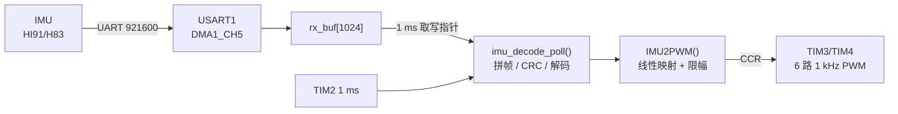

# IMU_UART2PWM

基于 **STM32F103C8T6** 的串口 → PWM 桥接固件：把 HiPNUC（HI91/H83）IMU 的 UART 数据帧解析后，用 6 路 1 kHz PWM 的占空比输出三轴角速度与加速度。

**为什么需要它**：下游控制设备只能读 PWM，读不了串口。本板夹在 IMU 和控制设备之间，IMU 侧解析私有协议，设备侧只需测占空比（物理量 0 对应 50%），无需改动下游固件。

---

## 1. 功能

- USART1 + DMA 循环接收：921600-8-N-1，1024 字节环形缓冲
- 流式拼帧：搜索 `5A A5` 帧头，支持缓冲回卷、半帧续拼、假帧头重同步
- CRC16-CCITT 校验，失败时丢 1 字节重新同步
- 解析 H83 帧（`tag=0x83`、`bitmap=0x0B`），取出 `acc[3]` / `gyr[3]` / `rpy[3]`
- 限幅：±70 m/s²、±20 rad/s、±180°，防止 PWM 越界
- 1 ms 轮询新数据，解出帧立即刷新 PWM；DMA 溢出自动重同步
- PA1/PA2/PA3 三色 LED 心跳指示

---

## 2. 软件架构

全部逻辑运行在 TIM2 的 **1 ms 中断**中，主循环为空，属于中断驱动的前后台结构。

### 2.1 数据流



### 2.2 分层说明

| 模块 | 文件                                     | 职责                                           |
| ---- | ---------------------------------------- | ---------------------------------------------- |
| 应用 | `main.c`                                 | 初始化、1 ms 回调、`IMU2PWM()` 映射、LED       |
| 协议 | `imu_decode.c/.h`                        | 环形缓冲增量解码、帧结构、`g_imu_rx_stat` 统计 |
| 校验 | `crc.c`                                  | CRC16-CCITT 计算与整帧校验                     |
| 驱动 | `usart.c` / `tim.c` / `gpio.c` / `dma.c` | CubeMX 生成的外设与引脚配置                    |

解码要点：只处理 `[上次结束位置, DMA 写指针)` 的增量数据；跨回卷的一帧先拉直再按结构体访问；溢出（两次轮询间写指针前进超过一圈）则跳到当前写指针重新同步。

---

## 3. 协议与映射

```
5A A5 | LEN(2, LE) | CRC(2) | Payload(LEN)
```

CRC16-CCITT 覆盖 `SOF + LEN + Payload`；H83 数据域 44 字节，`tag = 0x83`、`data_bitmap = 0x0B`，其后是 `acc` / `gyr` / `rpy` 各 3 个 float。

$$\text{CCR} = (\text{value} + \text{MAX}) \times \frac{\text{ARR} + 1}{2 \times \text{MAX}}$$

| 信号        | 通道       | 引脚            |
| ----------- | ---------- | --------------- |
| `gyr[0..2]` | TIM3_CH1~3 | PA6 / PA7 / PB0 |
| `acc[0..2]` | TIM4_CH1~3 | PB6 / PB7 / PB8 |
| LED         | GPIO       | PA1 / PA2 / PA3 |

PWM：72 MHz ÷ 2 ÷ 36000 = **1 kHz**，分辨率 36000 级；物理量 0 对应 50% 占空比。

---

## 4. 构建与可调项

Keil MDK 打开 `MDK-ARM/IMU_UART2PWM.uvprojx` 编译，DAP-Link 下载；外设配置用 STM32CubeMX 打开 `IMU_UART2PWM.ioc`。

- `main.c`：`RX_BUF_SIZE`、映射公式、LED 翻转周期
- `imu_decode.h`：`MAX_ACC` / `MAX_GYR` / `MAX_RPY`
- IMU 侧须为 921600 8-N-1，协议选 HI91 / H83
